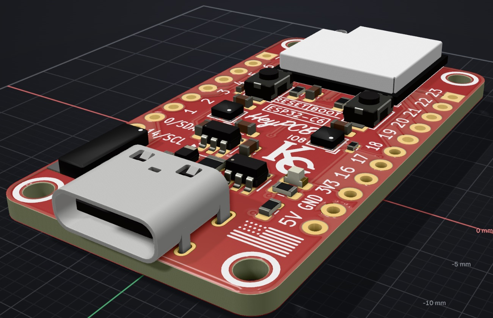
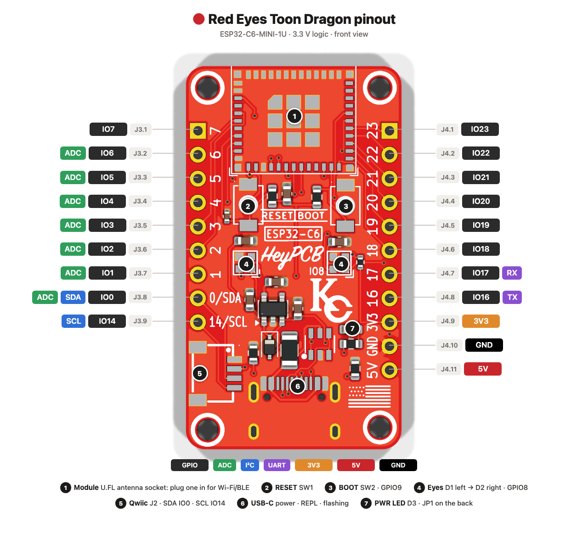
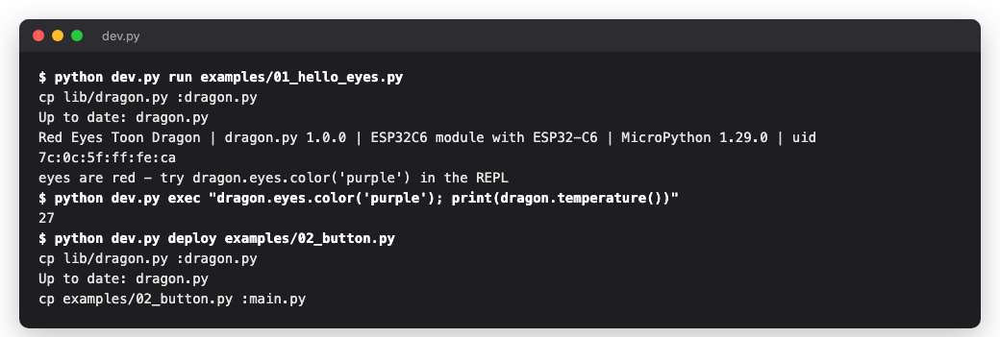
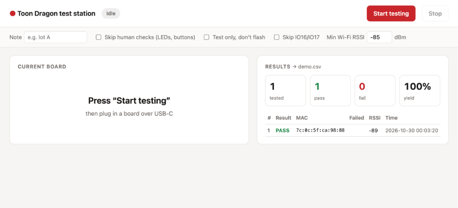
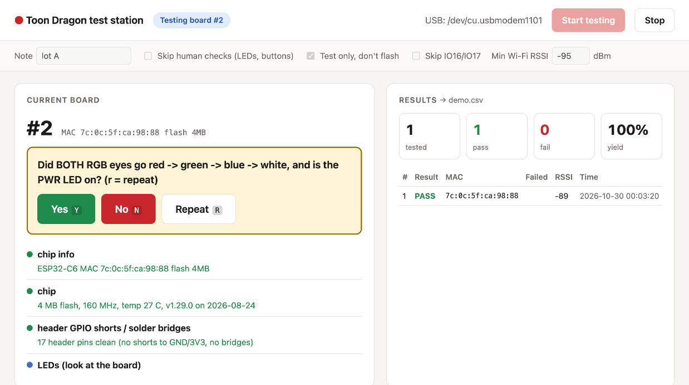
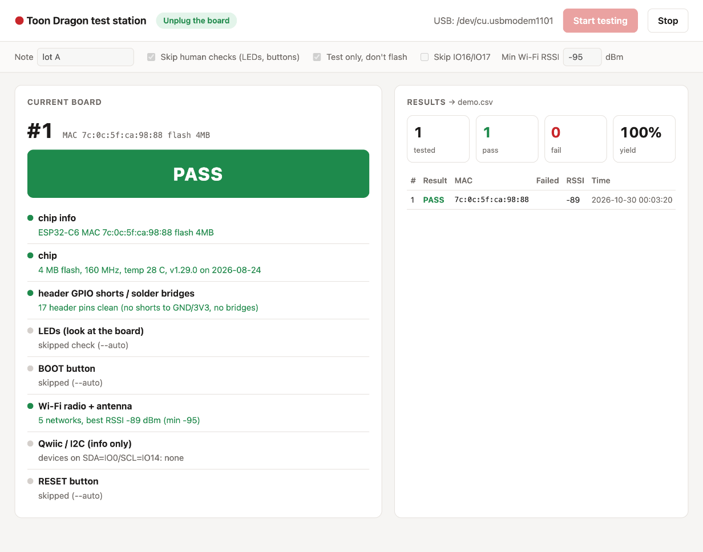
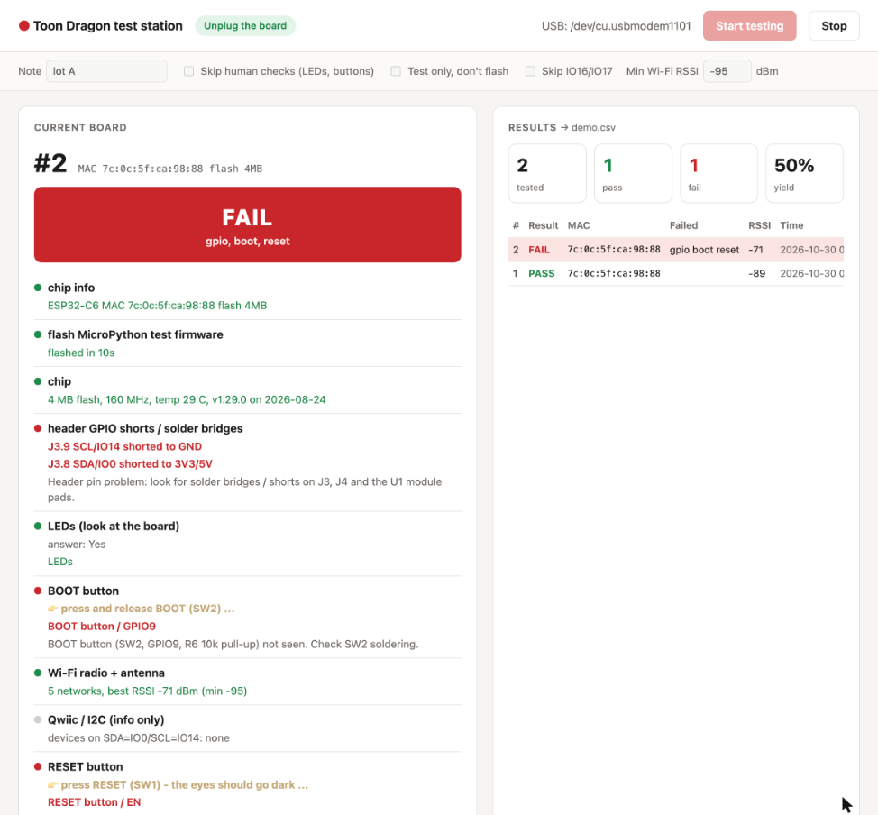
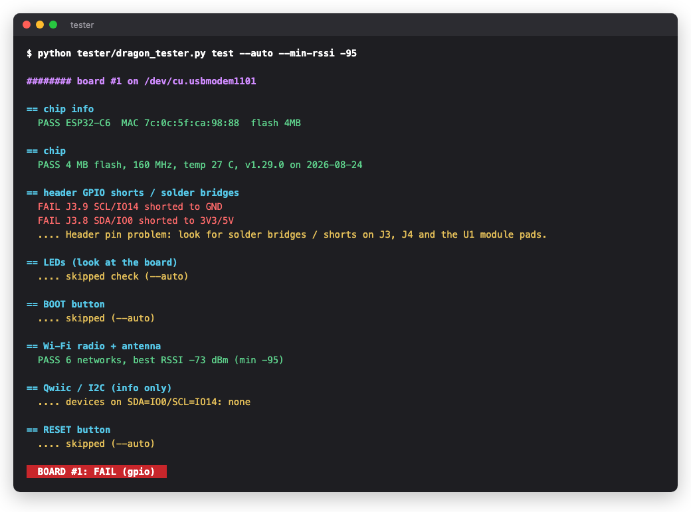

# Red Eyes Toon Dragon



An ESP32-C6 board with two RGB eyes, USB-C, Qwiic and 20 header pins. This repo has
the code to program it and a station to flash and test a batch of boards.

Board design: <https://heypcb.ai/p/961e9487c50d?view=pcb>



## Set up (once)

You need Python 3.9+ and a USB-C cable that carries data.

```bash
git clone https://github.com/enkhbold470/red-toon-dragon-tester
cd red-toon-dragon-tester
python3 -m venv .venv && source .venv/bin/activate   # Windows: .venv\Scripts\activate
pip install -r requirements.txt
```

Linux only: `sudo usermod -aG dialout $USER`, then log out and back in.

## Program it

```bash
python dev.py setup                          # once per board: MicroPython + the dragon library
python dev.py run examples/01_hello_eyes.py  # eyes blink, then turn red
```



```python
import dragon

dragon.eyes.color("purple")          # both eyes
dragon.eyes.color((0, 80, 255), 1)   # right eye only (0 = left)
dragon.wait_button()                 # BOOT button
ip = dragon.wifi("ssid", "password")
sensors = dragon.i2c().scan()        # Qwiic port
```

| command | does |
|---|---|
| `python dev.py run app.py` | runs the file now and shows its output. Ctrl-C stops it. |
| `python dev.py deploy app.py` | runs it at every power-up |
| `python dev.py undeploy` | removes it |
| `python dev.py repl` | MicroPython prompt |
| `python dev.py secrets SSID PASSWORD` | saves Wi-Fi login on the board, not in git |
| `python dev.py doctor` | full hardware test |

Examples in [`examples/`](examples): blinking eyes, BOOT button colours, a phone colour
picker over Wi-Fi, Qwiic scan, temperature-coloured eyes, a Bluetooth beacon.

Arduino or ESP-IDF: include [`include/toon_dragon.h`](include/toon_dragon.h) and pick
"ESP32C6 Dev Module" with USB CDC On Boot enabled.

### With an AI coding agent

Open the repo in Claude Code, Codex or Cursor and describe what you want, for example
"blink the eyes faster when the chip gets hot". [`AGENTS.md`](AGENTS.md) tells the agent
how to run code on the board and read the output, and which pins it must not touch.
[`board/board.json`](board/board.json) lists every pin, part and net from the KiCad design.

## Test a batch of boards

```bash
python tester/dragon_web.py
```

**1. Press Start testing, then plug in a board.** The note goes into the results file.



**2. Look at the eyes.** They flash red, green, blue, white. Press `Y` if both eyes and
the PWR LED worked, `N` if not, `R` to see it again.



**3. Press BOOT, then RESET, when the screen asks.**

**4. Read the result, unplug, plug in the next board.** A failed test says which part to
check.

| PASS | FAIL |
|---|---|
|  |  |

The flash and the tests take about 30 s per board. Every board gets a row in
`tester/results.csv` and a log in `tester/logs/<mac>.log`.

Same thing in a terminal: `python tester/dragon_tester.py`



| option | use |
|---|---|
| Skip human checks / `--auto` | no LED question, no button presses |
| Test only / `--no-flash` | board already has MicroPython |
| Min Wi-Fi RSSI / `--min-rssi` | test one board with an antenna and one without, then set a value between their readings |
| `--app my_fw.bin` | flash your firmware after a PASS (`--app-offset 0x10000` for app-only images) |
| `--listen 0.0.0.0:8765` | open the station from a phone or another computer |

## What the tests check

| test | how | when it fails, check |
|---|---|---|
| chip | ESP32-C6 answers, 4 MB flash | U1 soldering, 3V3 (U2, C13, C3) |
| GPIO | each header pin read with pull-up and pull-down, then driven against the others | solder bridges on J3, J4 and U1 pads. J4.8 sits next to 3V3. |
| LEDs | you confirm the colours | GPIO8 and R7, then the D1 → D2 link. PWR LED dark: bridge JP1 on the back. |
| BOOT | GPIO9 goes low, then high | SW2, R6 |
| RESET | the chip restarts and the USB port drops | SW1, R5, C10 |
| Wi-Fi | sees a network above the RSSI limit | antenna on the U.FL socket |
| I²C | scans Qwiic, info only | your sensor needs its own pull-ups |

If no port shows up, try another cable. If the PWR LED is dark, check F1, D4 and U2. If
it's lit, check the J1 USB joints and U3. Still nothing: hold BOOT, tap RESET, let go of
BOOT and try again.

## Files

```
lib/dragon.py          board library (runs on the board)
examples/              example programs
dev.py                 run / deploy / repl
tester/                flash and test station
board/board.json       pins, parts and nets
include/toon_dragon.h  pin map for C
AGENTS.md              instructions for AI agents
docs/                  images; docs/src/pinout.html makes pinout.png
```

MIT license
